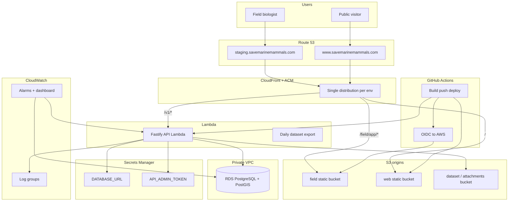
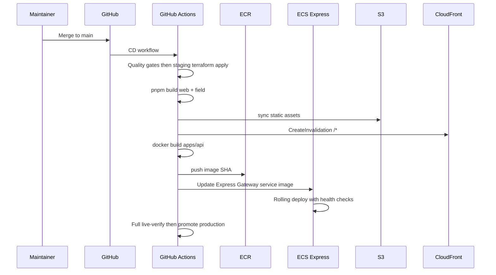

# AWS infrastructure layout (MMAP)

Sketch for staging and production on AWS. Implements M5 goals: managed PostgreSQL, S3 object storage, static frontends, containerized API, GitHub-driven deploys, and a path to blue/green canary on the API.

## Architecture



### Design choices

| Decision          | v1 (this sketch)                                                              | Upgrade path                                               |
| ----------------- | ----------------------------------------------------------------------------- | ---------------------------------------------------------- |
| API compute       | **Lambda** (Function URL) behind CloudFront `/v1/*` — pay per request         | Provisioned concurrency if sync latency needs a warm floor |
| Database          | **RDS PostgreSQL** (`db.t4g.micro` staging, `db.t4g.small` prod) with PostGIS | Aurora Serverless v2 if sync volume grows                  |
| Frontends         | **S3 + CloudFront** (build artifacts from CI)                                 | Same; invalidate cache on deploy                           |
| Object storage    | **S3** (dataset exports, future attachments)                                  | Lifecycle rules to Glacier for old snapshots               |
| Same-origin `/v1` | CloudFront **path behavior** proxies API                                      | Keeps field PWA working without `VITE_API_BASE_URL`        |
| Secrets           | **Secrets Manager**                                                           | Rotation for DB password via RDS integration               |
| IaC               | **Terraform** modules under `infra/terraform/`                                | Remote state in S3 + DynamoDB lock table                   |

### Why CloudFront path routing for `/v1`

Docker/nginx today proxies `/v1` to the API so browsers use same-origin requests. Replicate that at the edge on a **single** hostname per environment:

- `www.savemarinemammals.com/` (or staging host) → S3 web
- `…/field/app/*` → S3 field PWA
- `…/v1/*` → Lambda Function URL origin
- `…/dataset/latest/*` → data bucket snapshots

Leave `VITE_API_BASE_URL` **unset** in field/web production builds so the app continues to call relative `/v1/...` URLs.

### Network

```
VPC 10.0.0.0/16
├── public subnets (2 AZ)     — unused by API (kept for future / IGW routes)
├── private subnets (2 AZ)    — RDS + API Lambda ENIs
└── S3 gateway endpoint       — free; Lambda writes snapshots without NAT
```

RDS is not publicly accessible. The API Lambda runs in **private** subnets with the
RDS security group path. DB credentials are injected as Lambda environment from
Secrets Manager at apply time (no Secrets Manager VPC endpoint / NAT required).
Do **not** add NAT or interface PrivateLink endpoints for cost.

## Environments

|                     | Staging                                   | Production                                |
| ------------------- | ----------------------------------------- | ----------------------------------------- |
| Terraform workspace | `staging`                                 | `production`                              |
| API service         | `mmap-staging-api` (Lambda)               | `mmap-production-api` (Lambda)            |
| RDS instance        | `db.t4g.micro`, auto-stop after export    | `db.t4g.small`; auto-stop off by default  |
| CloudFront          | off until account verified (`enable_cdn`) | off until account verified (`enable_cdn`) |
| Deletion protection | off                                       | on                                        |
| Backup retention    | 7 days                                    | 30 days                                   |

## CloudFront (`enable_cdn`)

Staging and production set `enable_cdn = true` so a **single** distribution serves the
mission site at `/` and the field PWA at `/field/app/`, with same-origin `/v1`.

New or unverified AWS accounts are sometimes blocked from creating CloudFront
distributions. If apply fails on distribution create, temporarily set
`enable_cdn = false` in that environment’s `terraform.tfvars`. Terraform still
provisions networking, RDS, API Lambda, S3, monitoring, and the deploy role
(skips `module.cdn`).

| Capability                    | With `enable_cdn = false`                                                |
| ----------------------------- | ------------------------------------------------------------------------ |
| Live API + RDS + sync testing | Yes — use `terraform output -raw api_service_url`                        |
| ECR image deploy / migrations | Yes                                                                      |
| S3 static sync                | Yes (artifacts only; no public CloudFront URL)                           |
| Same-origin field/web on AWS  | No — re-enable CDN after verification                                    |
| Browser field app → live API  | Set `VITE_API_BASE_URL` to the Function URL and `cors_origins` in tfvars |

After CDN is enabled (or re-enabled):

1. Confirm `enable_cdn = true` in `terraform.tfvars`
2. `terraform apply`
3. Prefer same-origin field/web URLs (`/field/app/`); leave `VITE_API_BASE_URL` unset for production builds
4. Optional: store `WEB_CLOUDFRONT_ID` for emergency **Deploy AWS** (CD passes the id from terraform apply)

Smoke / live-verify read `api_service_url` from Terraform state. App deploy resolves the
Function URL via `aws lambda get-function-url-config` (no `API_SERVICE_URL` secret).

## Repository layout

```
infra/
├── README.md                          Quick start for operators
└── terraform/
    ├── README.md
    ├── versions.tf                    Provider pins
    ├── modules/
    │   ├── networking/                VPC, subnets, SGs, S3 gateway endpoint
    │   ├── database/                RDS PostgreSQL 16 + parameter group
    │   ├── storage/                 S3 buckets (web, field, dataset)
    │   ├── api/                     Lambda Function URL + export schedule + IAM
    │   ├── cdn/                     CloudFront (+ ACM/Route 53 when domains set)
    │   ├── monitoring/              CloudWatch alarms + dashboard
    │   └── github-oidc/             Per-env IAM deploy role (OIDC provider is bootstrap)
    └── environments/
        ├── staging/
        │   ├── main.tf                Composes modules
        │   ├── variables.tf
        │   ├── outputs.tf
        │   ├── terraform.tfvars.example
        │   └── backend.tf.example     S3 remote state template
        └── production/
            └── (same structure)

.github/workflows/
├── ci.yml                             PR quality + CodeQL + terraform plan
├── cd.yml                             Progressive staging → production CD
├── release-staging.yml                Manual staging infra+app+verify
└── _deploy-app.yml / _verify-env.yml  Reusable deploy and live-verify

docs/ops/
├── AWS_INFRA.md                       This document
└── DEPLOYMENT.md                      Promotion checklist & runbooks
```

## Module responsibilities

### `networking`

- VPC, public/private subnets across 2 AZs
- Security groups: `api-connector-sg`, `rds-sg`
- S3 gateway endpoint (no interface PrivateLink endpoints)
- Internet gateway for ECS task egress to AWS APIs

### `database`

- RDS PostgreSQL 16 (`db.t4g.micro` staging / `db.t4g.small` production), single-AZ
- Custom parameter group (`postgres16` family); PostGIS via extension in the database, not RDS parameters
- Subnet group (private subnets); not publicly accessible
- Automated backups, encryption at rest, RDS-managed master secret in Secrets Manager
- Outputs: `db_instance_id`, `database_url_secret_arn`, `database_secret_kms_key_arn`

### `storage`

- `mmap-{env}-web-static` — public read via CloudFront OAC
- `mmap-{env}-field-static` — public read via CloudFront OAC
- `mmap-{env}-data` — private; API IAM role read/write for exports/attachments
- Versioning on data bucket (no Glacier lifecycle rule yet)

### `api`

- ECR repository for `apps/api` image
- ECS Express Gateway service (managed ALB + Fargate):
  - Image from ECR (CI updates image; Terraform ignores image drift after create)
  - Tasks in public subnets; security group allows RDS :5432
  - Secrets Manager refs for `DATABASE_URL` and `API_ADMIN_TOKEN`
  - `CORS_ORIGIN` = site CloudFront URL (custom domain) when configured
  - Health check path `/v1/health`
  - Auto scaling: `min_task_count = 1` (use `staging-hibernate.ts` to override at runtime)
- CloudWatch log group `/{name_prefix}/api` (e.g. `/mmap-staging/api`)
- IAM roles: execution, infrastructure (Express), task (S3 data + secrets)

### `cdn`

- One CloudFront distribution (web + field) with:
  - Default behavior → S3 web bucket (`/`, `/app`, `/docs`, …)
  - `/field/app` and `/field/app/*` → S3 field bucket (keys under `field/app/`)
  - `/v1/*` and `/api/*` → ECS Express API origin (HTTPS only); OpenAPI Swagger UI is at
    `/api/docs` so UI HTML and `/api/docs/static/*` assets stay on the API origin (web SPA keeps `/docs`)
  - Legacy `/openapi*` → 301 `/api/docs*`
  - CloudFront Function SPA fallback for web and field deep links; production apex → www 301
  - Response headers policy (HSTS) when a custom domain is configured
- Default CloudFront certificate when `domain_name` is empty
- When `domain_name` is set: shared bootstrap ACM (apex + wildcard), Route 53 aliases
  - Staging: `staging.savemarinemammals.com`
  - Production: `www.savemarinemammals.com` (canonical); apex redirects to www

### `monitoring`

- Alarms: ECS CPU high, RDS free storage low (names: `{name_prefix}-ecs-cpu-high`, `{name_prefix}-rds-low-storage`)
- Dashboard: `{name_prefix}-overview` (health-check URL text widget)
- API log group lives in the **api** module, not monitoring

### `github-oidc`

- Per-environment deploy role (`mmap-{env}-github-deploy`) that trusts the **shared** account OIDC provider created by bootstrap
- Policies: ECR push, ECS Express update/describe, S3 sync to static buckets, CloudFront invalidation

## CI/CD flow



**Staging:** CD on merge to `main`, or **Release staging** from a feature branch (infra + app + full live-verify).

**Production:** automatic CD promotion after staging full live-verify succeeds (smoke live-verify after production deploy).

Database migrations run on **API container startup** (before the process listens), so ECS health checks only pass after schema is applied. RDS is private, so GitHub-hosted runners cannot migrate directly.

ECS injects the RDS-managed Secrets Manager JSON into `DATABASE_URL` and sets non-secret `DB_HOST` / `DB_PORT` / `DB_NAME`. The API merges them via `apps/api/src/cli/database-url.ts`. Local/CI use a plain PostgreSQL URL.

Never commit database credentials to the repository or Terraform state.

## Blue/green and canary (phase 2)

ECS Express uses **rolling deployment** with health checks — sufficient for M5 launch.

For canary traffic shifting on the API:

1. Move from Express to an explicit Application Load Balancer with two ECS Fargate target groups (blue/green).
2. Use **CodeDeploy** `ECSAllAtOnce` or `Linear10PercentEvery1Minutes` deployment config.
3. Point CloudFront `/v1/*` origin at that ALB.
4. Keep frontends on S3/CloudFront unchanged.

Static frontends already support safe rollback: redeploy previous S3 object version + CloudFront invalidation.

## Cost model (us-east-1, Lambda + daily snapshots)

The API runs as **Lambda** (no ALB/Fargate/public task IPs). Public dataset reads are
**daily S3 snapshots** at `/dataset/latest/*` (CloudFront → data bucket). Sync remains
`POST /v1/sync/batch` on the Function URL (also via CloudFront `/v1/*`).

| Resource (per environment)                  | Approx $/mo | Notes                                               |
| ------------------------------------------- | ----------- | --------------------------------------------------- |
| Lambda sync + daily export (pilot traffic)  | ~$0–2       | Request-priced; cold starts OK for marina Wi‑Fi     |
| RDS `db.t4g.micro` / `small` when running   | ~$14 / ~$25 | Stop when idle (`enable_db_auto_stop` or hibernate) |
| RDS storage (20 GB gp3) while stopped       | ~$2         | Data retained                                       |
| S3 + CloudFront + snapshots + Secrets + KMS | ~$1–5       | Dominates idle bill when RDS is stopped             |
| Public IPv4 / ALB / Fargate                 | **$0**      | Removed with ECS Express                            |
| NAT / interface VPC endpoints               | **$0**      | Do not add                                          |
| **Prod, RDS always on, idle sync**          | **~$20–35** | RDS + edge                                          |
| **Staging, RDS auto-stopped after export**  | **~$3–8**   | Storage + edge; start before campaigns              |
| **Idle (stack destroyed)**                  | **~$0–2**   | Bootstrap state/locks only                          |

**Operating model:** keep bootstrap (state bucket, lock table, OIDC) always on.
Treat staging as ephemeral — apply when needed, destroy when idle.
See [Ephemeral staging](#ephemeral-staging) and [infra/README.md](../../infra/README.md).

When a full teardown is too heavy, [hibernate staging](#hibernate-staging-scale-to-zero)
stops RDS only (API is already request-priced).

Apply for **AWS Activate** (nonprofit) to offset year-one cost when the stack is up.

## Ephemeral staging

Staging is not required 24/7 for a nonprofit pilot. Default practice:

1. **Create** when you need demos, UAT, or pre-production validation (`terraform apply` or **Release staging** workflow).
2. **Destroy** when idle so RDS + VPC stop billing (`terraform destroy` against the staging root only).
3. **Never destroy** bootstrap: S3 state bucket `mmap-terraform-state-*`, DynamoDB lock table, shared GitHub OIDC provider, Terraform CI role.

Cold start is typically several minutes for RDS (Lambda is seconds). Local Docker remains the day-to-day development path ([DEVELOPMENT.md](../DEVELOPMENT.md)).

Local destroy (Windows PowerShell), after `aws login`:

```powershell
cd infra/terraform/environments/staging
terraform init -input=false `
  "-backend-config=bucket=mmap-terraform-state-963120167952" `
  "-backend-config=key=staging/terraform.tfstate" `
  "-backend-config=region=us-east-1" `
  "-backend-config=dynamodb_table=mmap-terraform-locks"
terraform plan -destroy -var-file=terraform.tfvars
terraform destroy -var-file=terraform.tfvars
```

Recreate with the same `init`, then `terraform apply -var-file=terraform.tfvars` (or the **Release staging** GitHub workflow). Confirm only `mmap-staging-*` resources change — bootstrap stays untouched.

If re-apply fails because `mmap-staging/api-admin-token` is still in the Secrets Manager
recovery window (from a destroy before `recovery_window_in_days = 0` was set), force-delete
it once — see [FM-03 § soft-deleted secret](runbooks/FM-03-terraform-state-or-apply.md).

## Hibernate staging (scale to zero)

`scripts/staging-hibernate.ts` reduces spend **without** destroying staging. Use it when
you want the stack to stay provisioned (same Function URL / CDN, same state) but idle.

The API is already Lambda (no ALB/Fargate). Hibernation **stops RDS** only. Staging also
defaults `enable_db_auto_stop = true` (start before the daily export, stop afterward).

```powershell
# Show current state and estimated monthly cost
pnpm exec tsx scripts/staging-hibernate.ts status

# Stop RDS
pnpm exec tsx scripts/staging-hibernate.ts hibernate

# Bring staging back (RDS start takes several minutes)
pnpm exec tsx scripts/staging-hibernate.ts resume
```

| Option       | Effect                                        |
| ------------ | --------------------------------------------- |
| `--dry-run`  | Print AWS calls without executing them        |
| `AWS_REGION` | Environment variable, defaults to `us-east-1` |

### What hibernation does and does not save

| Component                    | Hibernated | Note                                |
| ---------------------------- | ---------- | ----------------------------------- |
| Lambda API                   | n/a        | Already pay-per-request             |
| RDS instance hours (~$12/mo) | stopped    | Data preserved; storage still bills |
| RDS storage (~$2/mo)         | **bills**  | 20 GB gp3 retained                  |
| S3 snapshots + CloudFront    | **bills**  | Near-zero at pilot traffic          |

**Hibernated floor: ~$2–5/mo.** For ~$0/mo use [Ephemeral staging](#ephemeral-staging) and
destroy the stack instead.

### Caveats

- **RDS auto-starts after 7 days.** AWS restarts stopped instances automatically; re-run
  `hibernate` or destroy the stack for longer idle periods.
- **Sync needs a running DB.** If RDS is stopped, `POST /v1/sync/batch` fails until you
  `resume` (or wait for the scheduled pre-export start when `enable_db_auto_stop` is on).
- **The script is safe to re-run.** It reads current state first and skips resources that
  are already stopped or absent (for example after a destroy).

## Related docs

- [DEPLOYMENT.md](DEPLOYMENT.md) — promotion checklist and restore drill
- [../REQUIREMENTS.md](../REQUIREMENTS.md) — NFR and storage requirements
- [../../infra/README.md](../../infra/README.md) — Terraform operator guide
